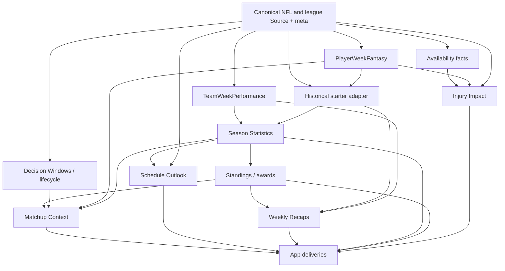

# Superseded target architecture — Package 1 historical review basis

The user approved target B after independent review. The current proposed design is [Package 1b review resolution](projection-architecture-review-resolution.md). Where the two documents conflict, Package 1b supersedes the earlier persistence, selection, registry and migration recommendations. This original document remains evidence for the independent review, not the current operative contract. See #1451 for status and gates.

---

# Projection architecture consolidation — AC1–AC5

Status: review candidate, 2026-11-27. Refs #1451; architecture-first package authorized, production implementation NOT authorized by this package. This is shared research/audit evidence and a proposed specification, not an adopted ADR or a second backlog. Operative checklist/decision gates live only in #1451. Reviewed repository revision: f417fbc4a735b9baf38bc5b948963940f7210cce. Existing CP3 drafts/frozen protocol untouched.

## Executive decision proposal

Keep the existing Source -> Shared Derived -> Consumer architecture and existing productive models, persisted products and writer prefixes for the first migration. The missing owner is the reusable forecast composition layer, not a second player scoring system or an extra data product for every mathematical step. Centralize reusable calculation and typed inputs/outputs in the Shared Derived library; use the existing materializers as compatibility adapters. Distinguish forecast intent, horizon, evidence cutoff and roster policy. Preserve conditional player points, historical facts, historical reconstructed projections and neutral mathematical A1/A2. Only after parity and independent review introduce statistically improved model versions; never change an already-used registered model in place. If later multiple consumers need exactly the same expensive horizon-specific forecast set or immutable observation history, prefer ONE explicitly authorized neutral league-forecast product, not separate team-strength/availability/BB/manager probability datasets. Do not introduce the prefix in AC6 parity migration. A persisted forecast is not necessary to establish the common calculation owner today.

## AC1 — evidence and inventory

### Reproduction and limits

Companion `audit_projection_architecture.cjs` reads explicitly pinned Git blobs; run from repo root:

```sh
node research/matchup-projections/2026/audit_projection_architecture.cjs --ref f417fbc4a735b9baf38bc5b948963940f7210cce --league nfl-reise --season 2026 --references > /tmp/projection-architecture-audit.json
```

It emits blob receipts, product/delivery parity, current conditional player coverage, historical probability comparisons (including missing rows), declared dependency topological levels and optional tracked-file reference candidates. The pure audit functions were actually executed in V8 with 12 real pinned GitHub connector JSON blobs, and the saved module was read back and parsed in V8. Full Git CLI, exhaustive tracked reference grep and a real clean-root replay were NOT run: `git ls-remote https://github.com/Lolindhir/fantasy-app.git HEAD` failed DNS in the execution environment. Targeted GitHub code searches for product/file names and field names, complete recursive tree (17,292 entries, not truncated), contract/read-path inspections and representative source files support the inventory. Default-branch search is not a pinned exhaustive grep; high-hit queries were capped. The exact full coverage gate remains open, including dynamic path construction and uninspected scripts. A declared acyclic graph is not proof no other edges exist. Large Availability season file not read in full; use contract, code and #1616 production proof, not an invented scan count. No tests/CI or independent Architecture Review claimed on behalf of this proposal.

Rules consulted: CHAT_START.md, AGENTS.md, app context routing and relevant sections of .ai-context/manual/{ai-guidance,architecture-review,work-tracking,workflow-monitoring,workflow-publication,architecture,domain,data-sources,decisions,handbook,source-of-truth-matrix,derived-models,derived-clean-root-restore}.yaml/.md; relevant product contracts; fantasy-management/AGENTS.md and source/rule/workflow/weekly-decision docs. No new normative rule adopted. For actual architecture changes read the complete mandatory ordered context and applicable product contracts before code writes.

### Product and producer matrix (observed)

Paths below are relative to the repository; L=CanonicalLeagueID, S=season, W=week. Canonical identities, never team display names, are authoritative. All productive App deliveries are downstream; research archive readbacks are historical evidence only.

| Owner / producer | Inputs and temporal scope | Principal result fields / model | Consumers and limits |
|---|---|---|---|
| `data-derived/player-week-fantasy/L/S/WW.json`; tools/player_week_fantasy_materialize.py, player_week_fantasy.py, player_week_fantasy_refresh.py; player-week-fantasy.yaml | Canonical NFL stats, roster/identity, schedule/game finality, league ScoringSettings, historical final weeks before target. Actual independently finalized; target roster may be provisionally previous-week only in live refresh. | Actual.State/Points; Projection.Status/Points/HistoryGames/PredictionRange(s)/RangeQuality/ParticipationCondition/AvailabilityAdjustmentApplied; header ProjectionModel V4-C/V4-C-PI1 and scoring SettingsHash, roster provenance. | matchup-context, season-statistics, weekly-recaps, team-injury-impact, Players.GameHistory, TWP optional parity, App PlayerWeekFantasy via player_week_fantasy_view; FM weekly decision/postmortem. Historical correction can change projection; not original observation. |
| `data-derived/nfl-player-availability/S.json`; tools/nfl_player_availability_materialize.py and derived_data_lib/nfl_player_availability.py | Canonical injuries, roster, snaps/stats, schedule; observed status/participation, not future p(play). | Availability states incl played, bye, reserve/report/unexplained nonparticipation, nonactive, unknown; evidence/coverage and population witness. | PlayerInjuryHistory and team-injury-impact; future participation training only lagged/as-of appropriate. #1590/#1616 complete factual product; no prediction here. |
| Decision Windows pure function `tools/derived_data_lib/decision_windows.py`; App delivery via RequestLeaguePublication/RequestLeague.ps1 | Source league/NFL schedule/finality/rosters, canonical current ESPN observation, lifecycle, atUtc, repairability-v1. | LineupWeek, slot definitions, active/bench/IR/taxi, player lock and slot states, availability, repairability. | Matchup context and projection, App DecisionWindows (not upstream), FM lineup/waiver. Unknown evidence stays unknown; OUT only explicit status. Not historical proof of injury probability. |
| `data-derived/team-week-performance/L/S/WW.json`; team_week_performance.py, materializer, verified source adapter | Final official league matchups, roster population/positions, scoring and slot definition; optional PWF parity, not PWF success gate. | ActualStarterPoints, OfficialMatchupPoints, PotentialPoints, MissedPoints, EfficiencyPercent, OptimalLineup, unfilled slots, awards. All-roster actual hindsight optimum; virtual empty zero slots allowed. | Season Stats mean weekly efficiency, Weekly Recaps actual/optimal lineups and awards, FM postmortems; distinct actual vs commissioner-adjusted official points. |
| `data-derived/season-statistics/L/S.json`; derived_data.py -> derived_data_lib/season_statistics.py -> models/season_stats/v1.py | Canonical season inputs via league_standings_sources (NOT persisted standings product), canonical matchup facts/finality, PWF and TWP. Regular season through min(LeagueScoredWeek, regular end); stops at first unusable week. | Points/PPG, RelativeScoringStrength, SoS, all-play ExpectedWins/Luck, GameLog PregameProjection/WinProbability/ProjectionDelta, ProjectedStarterPoints, ProjectedBestBallPoints, BestBallExcludedPlayers, LineupEfficiencyProjected/Actual, ProjectedBestBallStrength, Upsets. | Awards v2/v3 (Standings), live fallback/Hybrid, Outlook, Statistics/Standings/Hall of Fame. Unknown PWF not zero. ProjectedBestBallStrength not independent roster strength. |
| `data-derived/weekly-recaps/L/S.json`; weekly_recaps_materialize.py -> derived_data_lib/weekly_recaps.py | Canonical final weeks incl playoffs, schedule and identity/roster evidence, standings for neutral order, TWP and PWF; may skip whole recap week. | TeamPerformance, SeasonEfficiency (ratio of totals), WinProbabilities (whole percent), Upset/Level and counts, player awards; weekly-recap-v2 + team-range-v1/win-prob-v1. | Weeks, week statistics, team detail/schedule, matchup dialog, awards history and FM retrospective. Not same coverage as regular-season statistics. |
| `data-derived/team-injury-impact/L/S.json`; team_injury_impact_materialize.py -> derived_data_lib/team_injury_impact.py -> injury-impact-v1 | FINAL league weeks, same canonical roster/slots, factual availability, conditional PWF scoring hash; all roster incl IR/taxi. | ProjectedBest, ProjectedBestHealthy, Impact, IsLowerBound/HasUnknownEvidence, Counts, Injured.SingleReturnImpact, season totals. | App InjuryImpact; historical modeled opportunity cost, not actual loss or expected future team score. Conditional projections MUST remain accessible; applying p(play) first double-discounts the counterfactual. |
| `data-derived/matchup-context/L/S/{current,matchups,fantasy-game-context}.json`; matchup_context_materialize.py, derived_data_lib/matchup_context.py, fantasy_game_context.py, matchup_projection.py, hybrid_expected.py | Canonical matchups, NFL schedule/finality, standings (neutral order), lifecycle and Decision Windows at explicit instant, PWF same week and optional earlier Season Statistics. | Current starter team-range-v1 (method normal-independent-v1), win-prob-v1; ProjectedFinalScore, PregameProjectedScore, ScoredPoints, SD and 50/80/90 ranges, WinProbability/Raw/IsDeterministic, unavailable/bye/out/uncertain ids, axis. BestBallEfficiencyFallback (season-bestball-actual-efficiency-v1), DisplayProjectedScore/Method, DisplayWinProbability/Raw/Basis, separate HybridExpected (weekly-hybrid-actual-efficiency-preview-v1). | App publisher copies to Matchups, FantasyGameContext, MatchupProjections, archives. Hybrid generated but not selected as active display. Current stored context and projection omit exact AsOfUtc. |
| `data-derived/league-schedule-outlook/L/S/after-week-NN.json`, index.json; league_schedule_outlook_preview.py, materialize.py, models/schedule_outlook | Canonical pairing/bracket/record/WeekStructure/finality, same cutoff season-statistics and previous-season strength/points. No PWF of future target week. | schedule-outlook-v3 Strength.Value/CurrentRelative/PreviousRelative/CurrentWeight/GamesPlayed, RemainingSoS/Class, Upcoming; schedule-matchup-forecast-v1 ExpectedPoints, Upcoming WinProbability/ExpectedMargin/OpponentExpectedPoints, RemainingExpectedWins/RemainingWinProbability; playoff-odds-v4 (2026) exact mass, place support/status; historical 2024/25 v2 with integrated forecast. | Schedule/team details, Standings/Playoff picture/Overview. One historical mean used across remaining weeks in v1 forecast. A2 separate neutral exact scenario, no predictive weights. |
| `data-derived/league-standings/L/S.json`; derived_data.py -> league_standings_sources.py -> league_standings.py / standings-v1 + awards-v3 | Canonical league scores/brackets, season metadata, previous standings, optional persisted season-statistics for awards. | Official records and placements, awards incl Overperformer/Brick Wall (depends on historical projections/strength). | Standings/League App, matchup and recap neutral ordering. No central predictive owner. Actual standings and historical awards distinct. |

Adjacent out of scope: player-valuation salary-v1/SalaryProjected is economic valuation, not weekly score; NFL game/odds data are independent source/game forecasts, possible research features only; external redraft/dynasty/market forecasts are not our week-scoring model; player relevance, repairability and cap outlook are decisions/facts, not projected points. No league rule changes.

### Forecast fields and their exact current semantics

- PWF V4-C conditional point estimate and PI1 empirically calibrated conditional quantiles; not a full parametric distribution. Week 12 available rows all explicitly no availability adjustment. A missing player value cannot be converted to 0; a known no-game is a distinct state. PWF current live adapter requires exactly one configured league (resolve_target), whereas model inputs are already league/season/week/profile scoped. Do not hard-code that restriction in new shared components; generalizing existing App publication is separate scope.
- team-range-v1 derives sigma=(upper90-lower90)/(2*z90), sums independent starter variance. Final games replace projection with actual score; running game still uses full pregame projection, NOT actual-so-far plus full forecast. Bye and explicit OUT zero; uncertain full conditional. Incomplete required input -> null team mean/SD/ranges. Preserve exact ordering, rounding and legacy pregame field quirks (bye/OUT branch precedes pregame addition). Decision Windows failure can currently leave raw starter forecast without availability; preview unavailable. Do not silently improve behavior inside v1.
- win-prob-v1 uses normal difference CDF and complementary whole-percent display; no calibration. Equal deterministic scores -> 50/50 win share (not 50% literal win on both sides). No separately modeled tie probability. Keep raw tails, deterministic flag and independent exact mathematical support separate. Historical reconstruction uses actual recorded lineup with every starter modeled pregame, bye=false, not observed original submitted lineup.
- Season fallback mean historical projected BB times mean actual weekly efficiency, only chosen when original projected final is null, no final starters and sufficient fallback; separate EST chance from selected display means/SD (historical sample score SD >=3 distinct weeks). No mixing with live partially final points or historical recap.
- Hybrid locked actual + locked conditional projected + remaining active-roster deterministic max of projected means times mean actual weekly efficiency. Active bench/starter only, no IR/taxi, no bye/OUT, no locked bench, fixed locked slots; incomplete if required slot unfilled. No hybrid distribution or hybrid chance. This is a shadow, not statistical approval.
- Historical projected BB max of conditional means over entire historical matchup pool including IR/taxi, missing nonstarter excluded/counted, missing starter => null, model projection_values requires valid interval even for mean. Actual BB uses realized scores and is hindsight optimum. Injury impact uses conditional point only, two roster scenarios and explicit unknown/lower bound. Same optimization primitive; not same target, roster scope or missing-policy.
- Season Statistics LineupEfficiencyProjected=projected starter / projected BB; LineupEfficiencyActual=mean actual weekly ratios. Weekly Recaps SeasonEfficiency=sum actual / sum potential over recapped weeks (including playoffs). Both meaningful; forecast a new ManagerRealization target separately. Historical ProjectedBestBallStrength=mean projected BB * mean projected efficiency; approximate submitted lineup average, not independently predictive strength.
- Season Stats ExpectedWins=sum all-play weekly share with half ties (descriptive counterfactual), NOT future remaining wins. RelativeScoringStrength=actual PPG/league PPG; historical SoS based on opponents. Schedule v3 previous-season fade min(1,g/(R/2)); no repeated form weight. Future v1 score basis mean times that strength, pooled historical score SD, analytic Gaussian win share, neutral equal-unknown fallback with provenance. The v2 legacy playoffs also uses same scoring_basis and CDF; A2 v4 doesn't consume them. ExpectedWins naming must distinguish historical all-play, strict future expected wins=sum P(W), and expected standings win-equivalents=sum(P(W)+0.5 P(T)).
- A1/A2 (playoff-odds-v3/v4, #1693) exact W/T/L path mass, weights (1,1,1)/(99,2,99), equal-record splitting until final official table, exact numerator/denominator and reachability. No team strength, no PF/PA forecasts, no simulated zeros masquerading as impossible. Preserve versions and status. B–D (#1694) will use jointly calibrated probabilities and conditional scores; not independent strength. #1536 owns conditional bracket/title, multi-leg round aggregate.

### Direct consumer/read-path inventory

Verified via exact searches and pinned representative code. No claims of a complete dynamic reference scan yet.

| Shared result | Producer/adapter and consumer path |
|---|---|
| Player projection | player_week_fantasy_view.py maps canonical to Sleeper at boundary; player_week_fantasy_app_publish.py delivers PWF. DataApiService/DataService join same Season/Week by IDs (data.service.ts), player-week-projection.util.ts; league-matchups, fantasy-game-context-dialog, team-detail-dialog / team-lineup-tab, player-detail-dialog. Players read model load_projections/attach_projections -> GameHistory. PWF Actual optional strict parity in team_week_performance_materialize; historical scoring/reconciliation/backtests not independent scoring owners. |
| Current score/chance | matchup_context_app_publish.py copies persisted result; DataService enrichFantasyGameContextWithProjections; league-matchups.ts uses DisplayProjectedScore/DisplayWinProbability, fallback method/EST flags; fantasy-game-context-dialog and projection-range components use published ranges/axis. Weeks uses current or historical contexts/recaps. No new calculation in Angular. |
| Historical score/chance | season_statistics.py::week_games and weekly_recaps.py::pregame_win_probabilities independently prepare identical historical starter inputs for shared v1 models. season_statistics_app_publish.py and weekly_recaps_app_publish.py read persisted products; statistics/standings/Hall of Fame, weeks-view.util.ts, week recap/dialog and team-schedule-data.service.ts. Awards-v3 reads GameLog ProjectionDelta/League adjusted difference and strength; do not silently change award semantics in migration. |
| Actual lineup efficiency | TWP -> Recaps TeamPerformance/SeasonEfficiency, lineup-efficiency.util.ts only maps/formats; team-detail-dialog Franchise Snapshot, Weeks efficiency grid, weekly stats, team schedule/dialog. Stats mean weekly ratio feeds hybrid/fallback; both preserved and clearly named in internal contract. |
| Future matchup/SoS/odds | league_schedule_outlook_app_publish.py -> ScheduleOutlook, DataService getScheduleOutlook -> standings-page.ts, team-schedule-tab.ts, league-matchups.ts and schedule-outlook-view.util.ts. Future game probabilities and A2 mathematical mass displayed separately. No independent Angular forecast. |
| Injury impact/history | player_injury_history_app_publish.py reads factual Availability; injury_impact_app_publish.py reads team-injury-impact (not future projection). Preserve these boundaries. |
| Fantasy Management | fantasy-management/_ai/MONITORING_AND_WEEKLY_DECISIONS.md, Week-Evidence Contract: repo PWF and MatchupProjections are secondary scenario evidence, not primary Start/Sit or validated win certainty; W11 ex-ante analysis explicitly names both App blobs, W11 postmortem reads TWP and PWF (Actual pending at observation). W10 and other historical analyses cite DecisionWindows/PWF. Preserve archived records, do not rewrite past decisions after model update. |
| Fantasy Operations | build_player_signal_dataset.py / build_player_signal_dataset_with_projection_extensions.py normalize external provider season projections, rank/consensus and comparable league core stats; build_kicker_streaming_inputs.py and analyze_kicker_streaming.py use external CBS/FFToday, Kicker context. season-projection-movement workflow is external full-season rank/core projection, not our PWF or central matchup owner. Current source rules preserve provenance and uncertainty. No requirement to make App pipeline depend on FM scripts or store FM decisions in shared data. |

### Pinned quantitative evidence (actual executed read-only checks)

PWF 2026/W12 blob 5fe991af614f617cbfc91304724f1b9f8a909d84: 840 records, 710 available all conditional and unadjusted, 130 insufficient-history, all Actual unavailable at this pre-final week. Partitions W1–12 in tree; no W13 PWF. TeamWeekPerformance W11 blob 7b83822113cf225b63fcc9b10fdc0f3182dd8f67. InjuryImpact 2026 blob f3f08ebd2d3d9e7e5246205b645f4347bc843703: 11 computed weeks, no unavailable weeks. Current matchup product 3bcb7dfcf8e4ecc9fc499b51a43848f70df4c3a9 embedded MatchupProjections equals App 7e34e2fcc315950f4d0b0701904c0f65e645f76a; Outlook snapshot f91ba29af61b1af220fa3bbd022cd5b76c9000e5 equals App 0b05c09dd5afd332c339a70a763a772b639a9547. Semantic JSON equality, not byte/hash equality of differently nested documents. Actual current projections all six teams use starter display and hybrid efficiency through W11. Schedule cutoff W11 not identical to live W12 information. Context lacks exact persisted AsOfUtc.

| Season | Stats team-weeks | Compared rows | Both known within rounding | Both unknown | Only one known | Above 0.505 pp difference | Unmatched stats rows |
|---|---:|---:|---:|---:|---:|---:|---:|
| 2024 | 84 | 84 | 78 | 6 | 0 | 0 | 0 |
| 2025 | 78 | 72 | 64 | 8 | 0 | 0 | 6 |
| 2026 | 66 | 66 | 66 | 0 | 0 | 0 | 0 |
| Total | 228 | 222 | 208 | 14 | 0 | 0 | 6 |

Four known probabilities and two null in 2025 W10 Statistics, no W10 Recap at all; code deliberately skips incomplete recap evidence, specific root cause not independently reproduced. Do not impute, do not infer missing week is zero, do not promise historic observed probabilities. 2024/25 recap coverage includes playoffs; compare only common regular-season team-week identities. Tolerance 0.505 percentage points accounts for integer display and 4-decimal probability rounding; 4 near rounding boundaries require exact raw-parity test during migration.

2026 same 11-week cutoff: mean weekly vs ratio totals (%): Team1 82.5657/82.6385, 2 80.4390/80.5750, 3 85.9385/85.8294, 4 85.3774/85.2852, 5 77.6019/77.3853, 6 82.5263/82.0977. These are different aggregation targets, not a bug or validated future coach skill.

Draft evidence inventory: #1620 CP3e target reconciliation; #1623 CP3f/g ex-ante participation and MC pilot; #1637 CP3i p(play) (base main); #1660 CP3j on CP3i; #1683 CP3k on CP3j; #1686 CP3l on CP3k; #1687 CP3m on CP3l; #1692 CP3n/o on CP3m; #1696 CP3p on CP3n/o. Nine open deferred drafts retained; no rebase/merge. CP3o frozen prospective candidates/holdout unchanged. CP3p no independent full CLI, no activation, no p(play) in layer calibration. Research outcomes inform later model choices, not AC6 formula changes.

## AC2 — semantic ownership and forecast taxonomy

| Concept | One logical owner | Distinction / boundary |
|---|---|---|
| League scoring, official scores, roster, schedule, finality, locks | canonical Source + lifecycle/Decision Windows and existing scoring functions | No forecast changes factual rules. LeagueScoredWeek distinct from NFL finality, lock, PWF Actual finality. |
| Conditional player score estimate/interval | PWF, #697 | Do not mix participation or future manager decisions into conditional performance. Role, usage, player form here. |
| Participation and effective player distribution | shared forecast layer #1451; factual Availability remains upstream | p(play) a research model; explicit BYE/OUT/unknown/limited role. If conditional estimate represents a mean, E[X]=p*E[X|play]; mixture with zero mass, not merely scale interval or subtract injury twice. Missing p unknown, not automatic zero/one. |
| Submitted lineup | existing team-range-v1 (legacy) and future versioned lineup forecast | Same current lineup held fixed; locked final actual, active legacy pregame. Not predicted manager decisions. |
| Roster potential | shared constrained optimizer + explicit pool/target | Max of point estimates is distinct from E[max of realized draws]. Separate all-roster historical comparison and actionable currently legal slots, free/locked, IR/taxi and evidence coverage. Future uncertainty about roster changes explicit. |
| Realized lineup efficiency | TWP per-week actual; shared aggregation of mean ratios and ratio totals | Retain regular vs all recapped scope and two historical targets. Manager forecast uses lag-only history, shrinkage/lineup choices; no blanket skill claim. |
| Expected manager performance | central Team Forecast #1451 | Estimate actual future score under plausible submitted choices and constraints. A submitted-lineup, historical fallback and hybrid are separately identified candidates, not one unlabeled target. |
| Descriptive strength | Season Statistics / Schedule Outlook | Historical PPG and previous fade. A baseline/prior feature, never separately reapplied after team forecast uses it. |
| Predictive team strength | central Team Forecast #1451 | Horizon-/target-specific manager score distribution, optional relative index only against explicit same-horizon league baseline. Long-horizon structural strength distinct from target-week injury/bye; do not simply extrapolate current lineup. |
| Matchup distribution | central Matchup Forecast #1451 | Joint score law or explicit legacy marginal approximation, W/T/L or legacy win share, margin, uncertainty and provenance. No additional unvalidated form adjustment. |
| Schedule / playoff / bracket | Outlook historical schedule; #1694 weighted scenario aggregation and #1536 title/rounds consume forecast | A1/A2 exact support independently maintained. PF/PA conditioned on same W/T/L draw; no incoherent independent scoring/tiebreak draws. Two-leg round is one matchup on combined scores; same team-week shared across pairings. |

Horizon policies: (a) live current week, fixed completed evidence and locked players; (b) pre-first-kickoff / per-player cutoff, observed immutable archive only if actually attested; (c) W+1–3 target-specific roster/availability/bye and forecast coverage; (d) remaining regular season conditional on future roster/role, (e) playoff/structural prior horizon. Current PWF only current target; until separately modeled future horizons, keep schedule historical baseline explicitly named, no disguised W13 player projections. Validate each horizon on its own cohort; shared time policy, not one universal decay. Player, availability, manager and residual calibration version-specific, lag-only, compare simple historical/neutral baselines and fixed holdout. Never optimize AC6 to improve metrics.

## AC3 — reusable components and physical product decision

Proposed module names are not approved file contracts. Reuse models/registry.py, existing model IDs/immutable PARAMS, weekly_lineup_optimizer.py, canonical player bridge and week_finality. PWF point/interval metadata currently not selected by TeamRange/WinProb registry; keep current implementation and version receipts, do not force unrelated registry migration. New model IDs/season selection only when new behavior approved.

1. Shared pure forecast input normalization: typed canonical roster/player/slot identity, settings hash, target week, evaluated cutoff, known final scores and explicit eligibility/evidence. Move duplicated historical input normalization and read helpers out of weekly_recaps into neutral Shared Derived helper (no derived function importing consumer generator). Historical helper receives explicit legacy policies so unchanged bye=false, missing handling, team ordering, raw vs rounded and upset thresholds.
2. Share pure constrained optimum adapter and evidence/coverage metadata using existing optimizer, not a replacement solver. TWP, Stats BB, Hybrid and InjuryImpact keep distinct policy wrappers and rounding/precision (Decimal vs float) and empty-slot policies. Do not refactor already versioned model numerical behavior in place; extract only parity-proven unchanged helper calls. Shared efficiency aggregation helpers distinguish mean-ratio/ratio-totals with explicit regular vs recap scope; legacy output names preserved.
3. Shared team forecast composition API (logical owner) accepts explicit inputs and selects named, versioned strategy. First migration ports existing submitted-lineup, seasonal fallback, hybrid preview, historical baseline as separate policy adapters; no arbitrary best-model selection or ensemble. Legacy display selection remains identical. No new availability or manager model. Current actual forecast owner remains active team-range-v1.
4. Shared matchup evaluation calls existing win-prob-v1 or existing schedule scoring_basis/CDF via version-specific adapter; avoid redefining CDF or changing legacy tail/rounding behavior. Historical recap and stats use common normalized input, separate rendering. v2 historical odds module remains immutable; schedule-matchup-forecast-v1 wrapper can reuse its shared scoring basis without importing an App consumer. A1/A2 remain independent.
5. Existing physical outputs and writer scopes unchanged during parity migration: current Matchup Context persists current forecast, Schedule Outlook persists its own after-week baseline at different target/cutoff, Recaps/Stats preserve historical reconstructions. Same semantic intent + same source/cutoff should get the same core result; different cutoff or policy must not be forced equal. Explicitly label current shared logical owner and the adapters; no new parallel computation in Angular or FM. If a single expensive future forecast must be reused by multiple materializers at the SAME cutoff, proposal for ONE `data-derived/league-forecast/L/S/...` product (not a product per layer) with explicit elevated prefix approval, model contract, restore cost and history policy; decision conditional on observed need after common calculation/coverage. Alternatives rejected now: put future whole-season forecasts into live Matchup Context; make descriptive Outlook own live forecast; duplicate all PWF; derive from App files; add scheduler/job just to publish a preview.

## AC4 — proposed internal contract (not a live JSON schema)

ForecastInputSet / ForecastSet internal value types. Explicit, immutable, consumer-neutral. Schema/version of types separate from algorithms. Store or return only applicable fields, no NaN/infinity, explicit null for unknown. Use existing canonical identity mappings at boundary, never mutable owner names. Example shape (illustrative, not data):

```yaml
ContractVersion: proposed-1
CanonicalLeagueID: ...
CanonicalLeagueSeasonID: ...
Season: ...
ScoringSettingsHash: ...
LineupDefinitionHash: ...
ForecastBasis:
  Intent: submitted-lineup | deterministic-roster-potential | realized-optimum-distribution | expected-manager-score | historical-team-score-baseline
  RosterPolicy: active-actionable | historical-all-roster | submitted-fixed | historical-score-only
  TargetWeek: ...
  Horizon: live | pregame | next-week | multiweek | structural
  AsOf:
    Kind: observed-instant | reconstructed-after-week | current-state
    EvaluationAtUtc: ... # supplied clock, not a model-read
    KnowledgeThroughWeek: ...
    EffectiveStateBoundaryUtc: ...
    ObservationEvidence: observed | reconstructed | provisional | unavailable
    InputFingerprint: ...
    SourceRevisionWitness: ... # attested checkout/receipt, not itself content invalidator
  Models:
    PlayerPoint: ...
    PlayerInterval: ...
    Participation: ... # null when not modeled
    RosterAggregation: ...
    Manager: ...
    TeamScore: ...
    Matchup: ...
    Calibration: ...
  Coverage:
    Status: available | partial | unavailable
    Reasons: [...]
    MissingInputs: [...]
    ExpectedResolvedCounts: ...
    FallbackBasis: ...
Teams:
  - CanonicalLeagueRosterID: ...
    TargetWeek: ...
    PointEstimate: ...
    ExpectedPoints: ... # only if defined as distribution mean
    FixedFinalPoints: ...
    RemainingDistribution:
      Kind: normal-independent-legacy | empirical-joint-scenario | ...
      Mean: ...
      StandardDeviation: ...
      Quantiles: ...
      RepresentationRef: ... # optional shared joint draws, never inferred from interval alone
    EligibilityCoverage: ...
    ModelAssumptions: ...
Matchups:
  - CanonicalLeagueMatchupID: ...
    TeamRosterIDs: [...]
    TargetWeek: ...
    TeamForecastRefs: [...]
    JointScoreLaw:
      Kind: independent-legacy | joint-scenarios | ...
      ScoreQuantization: ...
      CouplingPolicy: ...
    Outcomes: { WinA: null, Tie: null, WinB: null, LegacyWinShareA: null }
    ExpectedMargin: ...
    ConditionalScoreLawRef: ...
    MathematicalSupport: null # separately owned A1/A2, never statistical rounding
```

Logical identity: (canonical league-season, target week or explicitly defined multi-leg round, scoring profile hash, lineup definition hash where applicable, canonical roster(s)/matchup ID, intent/roster policy, as-of knowledge basis/state boundary, model-suite identity, accepted input content fingerprint). Same team-week performance reused where team has multiple matchups. Franchise across seasons only via accepted identity mapping (current schedule prior uses legacy TeamID; preserve parity but validate no wrong owner lineage in future models). Selection of v1 versions stays metadata-driven; league settings supply dynamic slot counts, scoring, tie/format, team/playoff count, target schedule, no hard-coded six/13/2026. A point estimate not necessarily a distribution mean; quantiles not enough to recover joint law. A v1 win share isn't a literal W/T/L triplet: unknown tie stays null, deterministic equal legacy 0.5 preserved, new probabilistic W/T/L only when modeled, mass conserved and ties use official scoring precision. No arbitrary 1% in predictive forecast; A2 weight is a reference assumption. Conditional PF/PA derived from the same score law conditioned on the outcome, not a second draw. If not enough evidence for joint dependence, explicit assumption and separate validation; exact mathematical possibility from A1/A2, not probability tails.

Provenance/time: actual wall-clock evaluation provided once by orchestrator; same accepted source content, settings, relevant model versions and semantic lock/waiver/finality state -> deterministic result. Exact observation time only when attested; source commit witness and generation receipt separated from semantic fingerprint to avoid writes on unrelated commits or every poll. For a future persisted latest snapshot, store effective state transition/knowledge cutoff and stable input content hash; a later no-op run updates monitoring receipt, not canonical payload. Historical observed snapshot archive (if authorized later) immutable and separate from corrected reconstructions; exact as-of observation key may be stored there. Never invent kickoff-time knowledge from finalized retrospective roster. Current context lacking exact persisted AsOfUtc is an evidence limit, not license to silently add timestamp to every JSON. Explicit missing history, unknown availability, incomplete roster/identity mismatch, wrong profile/version or week -> partial/unavailable, no false 0/50/100. Legacy equal-unknown schedule prior and display fallback retained and labeled, not automatic new model behavior. Keep immutable observed forecasts separate from training/evaluation outcome truth and new input revisions. Version calibration with upstream model IDs, fit and validation season/cutoff; no target/future labels. Full joint score law and future horizon estimation are research hypotheses, not AC6 production deliverables.

## AC5 — dependency DAG, order and publication semantics

Observed current `.github/workflows/league-live.yml`: source sync -> separate Standings job (materialize standings, App) -> League rebuild-and-retry transaction: derived refresh (history and newest scored TWP), PWF current + previous strict repair and App delivery, Matchup Context + App, league history App, Weekly Recaps + App, Season Statistics + App (fail-soft), Schedule Outlook incremental + App (fail-soft), other derived products, RequestLeaguePublication, cap outlook. `update-history.yml` materializes historical matchups/recaps/injury impact before all-season Season Stats, then all-season full Outlook (fail-on-error), App and index. `update-standings.yml` independent jobs for standings, all-finalized PWF and TWP (optional PWF parity, no dependency on PWF success). Availability source sync separate existing scope; current ESPN status snapshot independent. PWF actual missing stats keeps pending, no fake zero.

Required checked calculation edges (source code, not just documentation):



TWP optional PWF parity read is not a required readiness edge; do not introduce coupling. SeasonStatistics source adapter imports helper functions from WeeklyRecaps but does NOT read its persisted result nor standings product. Standings depends on persisted statistics for awards; recap and context depend on standings for neutral order. No required cycle in checked graph. Separate source/previous-year dependency edges and facts are implicit in diagram; cross-season prior flows only earlier -> later. Pure-function helper imports must not become product dependencies.

Two observed order risks: (1) Matchup Context reads previous persisted SeasonStatistics before fresh same-run materialization, potentially stale efficiency/fallback on week rollover. (2) Standings award materializer also reads persisted SeasonStatistics before the later League refresh. Source-only core standings can be current while optional derived awards lag. Actual W12 hybrid reads W11, no present stale result shown; these are possible timing inconsistencies, not claimed active outage. Additional historical cadence: PWF and TWP independent weekly correction; derived recap/statistics/outlook need explicit later regeneration, not assume a green League run implies upstream revisions final.

Recommended staged ordering:
- AC6A pure extraction with same writer order and same inputs; demonstrate parity first. Do not hide desired timing/behavior fixes as "result-neutral."
- AC6B bounded existing-prefix sequencing: in League job, after TWP and current/previous PWF refresh, build Season Statistics BEFORE Matchup Context and Schedule Outlook; retain fail-soft diagnostics and explicit cutoff. Recaps uses same inputs and standings, does not need Stats file. Keep existing Standings job/order and prefixes for this stage; explicitly acknowledge award prior-snapshot dependency. No new writer or schedule. This reorder can deliberately change fallback/hybrid only when the old order used earlier history; isolate diff and regression. Test both initial rollover and stats failure, ensure current submitted-lineup calculation independent of unavailable optional history. No future target data leak. In history path rebuild needed upstreams via existing accepted weekly orchestration, then season statistics and historical consumers/outlook with cutoff guard; history coverage/skip policy preserved.
- AC6C if user requires atomic same-revision awards/standings as well: separate reviewed/elevated option to consolidate existing live Standings publication into existing League transaction AFTER fresh stats and BEFORE context/recaps/League App, extending existing League writer's allowed prefix by data-derived/league-standings and adjusting existing job/sparse checkout/dependency (not new scheduler/credentials/writer class). This broadens failure blast radius (PWF/League fail could delay Standings), so do NOT choose implicitly. Alternative keep independent writer and make optional award statistics cutoff explicit; preserve availability of official standings. Recommend retain independent standings in initial migration, evaluate freshness/operational cost before any extension; existing weekly Standings job independent. No extra one-off workflows. Document precisely which changes are approved; do not move writer prefixes in this package.
- Future central forecast if added: source/accepted upstream products -> shared ForecastInputs (same evaluation time) -> forecast -> context/outlook weighted playoff/consumer render; no reverse from Outlook/Recap/App into forecast. Historical scoring baselines from canonical facts/lagged Stats, never current forecast outputs as training labels. A1/A2 can publish regardless of forecast availability. If eventual one new product, new prefix/restore/invalidation and source-revision policy must be explicitly approved, reuse existing rebuild-and-retry, no new job necessary by default.

Invalidation matrix:
| Change | Affected computation | Not invalidated by that signal alone |
|---|---|---|
| League scoring/slot settings or canonical identity correction | PWF/scoring, TWP, affected historical comparisons/forecast for exact scoring profile; lineage/correction policy | Other independent leagues/profiles (unless actual shared NFL source revision) |
| Canonical NFL stats/usage/roster revision in prior week | Strict affected PWF Actual and later conditional projections, availability/TWP if relevant, derived statistics/recaps/impact/outlook/forecasts | Original observed archive stays immutable |
| Current ESPN status, current lineup/roster or kickoff/finality transition | Decision Windows, current forecast, explicit lock/actual state; future only where relevant | Historical descriptive rows, exact A2 if standings/remaining pairings unchanged |
| Prior official score correction, revised finalized TWP | Stats/Recaps, historical baseline/efficiency and affected cutoffs/awards/outlook | Conditional player projections absent relevant NFL source/scoring change |
| New predictive model/version/calibration | Only selected new forecast versions and downstream predictive consumers; new fingerprint | Old observed forecasts, A1/A2 mathematical support, facts and legacy historical award definitions |
| Pairing/week structure change | Matchup/target and Outlook/A1/A2/weighted bracket scenarios | Independent per-player conditional score if NFL schedule/scoring unaffected |

Refresh/repair: retain accepted current and weekly history paths per historicalReconciliationStandard, bounded current scope, weekly historical source-revision checks, full rederivation/explicit documented exceptions; all output identity/fingerprint invalidation, no stale historical partition admitted as current truth. Rebuild-and-retry against latest main; on branch advancement discard generated commit and rerun, not rebase stale bytes; atomic writes/completeness index for partition sets; no-op semantic comparison, no volatile clock churn. Fail-closed on identity/settings/contradiction, no incorrect App fallback; for optional history or incomplete forecast preserve last coherent view only under existing policy, expose source cutoff/state and stale/unknown in a separately approved additive change. Do not make official standings or independent TWP depend on experimental forecasts. Cross-job revision provenance and retry tests required. Source correction/frozen original repair gates unchanged. Existing publication/monitoring contracts must reflect approved sequence and prefix changes. No manual writes to generated artifacts/data-meta; model selection by authorized hand-maintained metadata commit only after new version approval.

## Migration, CI and architecture self-review (Paket 2 input)

This is the author's self-review, not independent review. Required independent review basis: this proposal and runner on isolated research branch + pinned main + #1451 + relevant canonical contracts. Requested result pending. Existing-first: reuse shared products/optimizer/model registry/functions and existing writers; no new persisted prefix for AC6. Dynamic identity/time/profile explicitly modeled; known single-league live adapter and TeamID prior limitation surfaced. Ownership: one shared logical forecast composition, source facts independent; two distinct historical efficiencies and three predictive intents; no consumer feedback. Dependencies: checked graph acyclic, two stale-order risks identified; complete static/dynamic graph and actual historical refresh coverage still need full checkout scan. Temporal: unknown exact historical as-of remains reconstruction, no retrospective contamination. Compatibility: preserve every existing external JSON key/value/rounding, model selection, UI/award semantics, independent A1/A2 and FM decision records. Operations: same prefix/transaction for bounded reorder, elevated option separated; no credential/workflow additions. Unknown: null and coverage, no fake zeros. Documentation: implementation updates applicable .ai-context/manual/{architecture,decisions,data-sources,derived-models,player-week-fantasy,matchup-context,season-statistics,weekly-recaps,league-schedule-outlook,team-injury-impact,source-of-truth-matrix,workflow-publication,workflow-monitoring,derived-clean-root-restore}, data-derived README and file-local docs as applicable, Handbook only if public meaning changes; no duplicate agent docs or new normative ADR in this proposal. Architecture review required before implementation and targeted approval for elevated scope.

CI inventory inspected at pinned .github/ci-test-inventory.json; existing test families include test_derived_layer_import_gate, test_consumer_read_classification, test_nfl_source_matchup_projection, test_weekly_lineup_optimizer, test_win_prob, test_season_statistics, test_weekly_recaps (+materialize/app_publish), test_league_schedule_outlook (+document/materialize/preview/app_publish), test_team_injury_impact_materialize and existing identity/PWF/TWP tests. tools/ci_test_impact.py routes Shared Derived and schedule models to league-pwf-twp + consumer-restore, PWF/TWP additionally nfl-identity-replay; Core gate transitive Python imports/path literals and K1 classification do not prove semantic absence of all dynamic/other-language reads. AC1 research runner not production test or CI gate, no CI inventory change in proposal. AC6 add/extend actual selected Fast tests and routing regressions, Angular tests if delivery fields touched, no silent weakening; verify exact execution logs and Merge Gate. Recommend separately approved targeted Deep consumer-restore and league-pwf-twp where changed dependencies warrant, not mandatory automatic Deep or new workflow. Explicitly include existing Outlook restore path (own tests/exact real replay) and whole product restore limitations. No new test lane required by design; check Fast run times against budget after implementation.

AC7 acceptance evidence for subsequent authorized package:
- Before/after on pinned source and identical clock/inputs, all existing model IDs, fields and raw numerical outputs same for parity stage (compare semantic JSON, also byte/no-op where contract specifies); 2024/25/26 complete and unavailable/missing cohorts, 2025 W10 absent recap preserved, rounding thresholds incl four near boundaries and raw tiny tails, multiple settings/league/format fixture.
- Historical helper matches raw/rounded pregame score/chance and actual awards; exact output parity for all-roster BB, InjuryImpact counterfactual, mean vs totals efficiency, hybrid and fallback; preserve virtual-zero vs required-slot rules, unknown identity/projection/availability, OUT/bye, negative scores, locked bench/starter, IR/taxi, final vs live; no new CP3 model.
- Real clean-root Source -> required upstream products -> derived products -> App parity (no App as input), historical and current publication, controlled correction invalidation, no-op twice, source/fingerprint witness, branch-race retry. Existing source revision repairs remain reviewed; no manual generated edits.
- Isolated intended AC6B timing regression: old vs fresh stats cutoff rollover, optional history failure, correct prior-only fallback, no future leakage, only expected display/preview delta; core official standings and independent TWP unaffected. If changed standings scope later, separate review and explicit availability/rollback tests.
- Consumer acceptance: App current vs historical joins same league/season/week and published values, schedule independent A2, UI unchanged where parity goal, FM reads remain valid and decision history immutable; exhaustive static candidate scan + semantic review of dynamic consumers before claiming complete coverage.
- Later independent research validation: pre-kickoff observed where available, reconstructed explicitly labeled, lag-only time split, frozen holdout, sample/coverage, MAE/bias/Brier/log loss/interval calibration and uncertainty by week/season; no superior model claim without evidence. Joint score consistency and horizon-specific coverage before #1694 and #1536.

Risk/rollback: AC6A reversible pure code extraction, revert focused PR and existing normal regeneration, no source changes; AC6B reversible existing order change, revert workflow command placement and regenerate normally; numerical timing delta separately approved. Any new persisted forecast prefix or live Standings transaction expansion elevated with concrete blast-radius/rollback and separate user authorization; no experimental model activation in either parity step. No destructive data migration, bypass, force push, or special workflow.

## Review handoff and limitations

AC1 targeted inventory and actual pinned read-only checks are complete to the evidence available, but exhaustive Git CLI/reference/semantic coverage is NOT certified; close AC1 only once full candidate scan and outstanding reads checked (including large Availability and FM dynamic consumption). AC2–AC5 design proposals above ready for review, not approved for implementation; AC4 independent architecture review pending, AC5 writer/effect approval pending where required. Independent reviewer should explicitly challenge (a) no new persisted product initially vs same-cutoff reuse, (b) identity and temporal boundary, (c) two efficiency targets and historical recurrence, (d) prior Stats/Standings order, (e) compatibility and failure blast radius, (f) actual test routing, (g) completeness of remaining AC1 evidence. Review output dimensions per architecture-review.yaml; status:review normal handoff; result pending. No new production files, models, writers, contracts, governance or CI changes, no merge. CP3q stays deferred. Next substantive work after review/approval: AC6/7; outstanding AC1 reproduction/coverage gate must not be skipped.
