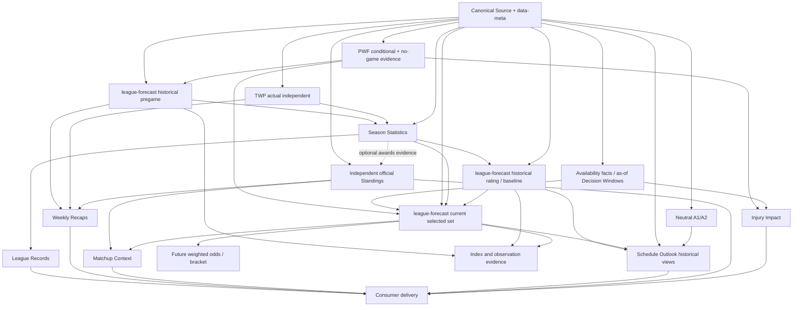

# Projection Architecture — Package 1b review resolution

Refs #1451, draft #1714. 2026-11-27. **Proposed technical specification for independent re-review; NOT production authorization or an adopted ADR.** User approved target B (central persisted forecast), one authoritative selected predictive forecast, registry integration and Package 1b design work. Supersedes conflicting target architecture, persistence and migration recommendations in `projection-architecture-ac1-ac5.md`; that document remains the original review basis and evidence. Operative work tracking remains exclusively in #1451. Independent review result changes-required: [review comment](https://github.com/Lolindhir/fantasy-app/issues/1451#issuecomment-7228208149), uploaded report 2026-11-27-review-1451-paket1.md. Original audit basis f417fbc4a735b9baf38bc5b948963940f7210cce, independent reviewer drift basis b9e916e79ce375ec8721a976a77cc915c61b1dfa, this resolution inspection main 46de0b7cc9026039b668361acca4055f0210253c. No CP3 research optimization or productive writer, schema, model, source or governance mutation.

## 1. Decisions and review dispositions

| Finding | Design disposition | Remaining acceptance |
|---|---|---|
| F1 | Known bye/no-game with evidence, identity and population repair; conditional PWF remains not applicable, effective score deterministically zero | Isolated historical value delta, actual fixtures/rebuild and targeted approval |
| F2 | One owner and one selected forecast per target and information set; explicit current/future selection, no implicit model-quality claim | Consumer switch after shadow/parity and separately approved semantic delta |
| F3 | Persisted league-forecast owns historical and current/future predictions; pure library transitional extraction, not permanent alternate owners | Historical consumer parity and retirement, new prefix elevated approval |
| F4 | V4-C and PI1 immutable registered algorithms, separate trained state; Python and PowerShell metadata validators updated together | Exact replay parity, all season configs, production import closure, separate metadata activation approval |
| F5 | Historical forecasts before Statistics, current forecasts after Statistics; independent official Standings retained, optional awards freshness separately handled | Rollover/failure and race tests; explicit approval for any Standings prefix extension |
| F6 | Actual read-site witnesses and same-cohort efficiencies recorded; FM scan completed for 60 tracked Python files; partition-level target DAG | Independent Python current/history No-op trace confirms 17 witnesses; N1–N4 included below. Remaining runtime/semantic classification is a mandatory AC6A acceptance gate, not certified complete. |
| F7 | Existing exclusions are documented; forecast historical restore required, fixed-clock current restore separate; retain explicit justified exceptions | Actual restore, coverage inventory, no-op/clock tests |
| F8 | Prefer direct forecast product for FM; current governance permits read-only App access, so not an existing proven policy violation | FM migration/decision-evidence tests; no historical rewrite |
| F9 | Legacy schedule v1 preserved; new selection refuses unknown numeric defaults, known zero variance handled correctly, explicit neutral comparator not primary | Registry/legacy equivalence and separately approved new semantic version |
| F10 | League Records ADR-100 included, code and live/history publication verified; App mapper/weeks-view changed paths identified as relevant consumer follow-up; full semantic drift recheck remains a gate | Recheck current main and final consumer references before cutover |

The original review's binding items are design-resolved where specified, not implemented. Independent re-review of head 27a917b6 against main 2ac5ef43 returned changes-required (A–C only). This revision addresses A–C; short independent confirmation pending. F6 implementation evidence remains a mandatory AC6A gate. AC2 hierarchy, Angular display-only math and A1/A2 separation retained.

## 2. Additional evidence and limitations

Actual read-only work in this resolution:
- Independent re-review dated 2026-11-27 (report `2026-11-27-re-review-1451-paket1b.md`, operative findings in #1451): standalone audit `--ref 46de0b7 --references` exit 0, 0.9 s, all 17 witnesses and 222 aligned team-weeks reproduced, max weekly difference zero. Reviewer independently ran a Python open audit hook including subprocesses on productive current/history materializers at main 2ac5ef43: 5,556 reads, all exit 0, semantic no-ops, no writes, no cycle observed. Availability 2025: 23,964 rows, Aubrey played/bye/played W9–11; W10 127 bye rows (DAL 34, KC 34, TEN 31, CIN 28). This closes the 2025 row-evidence gap, not all future/historical membership cases. Static exact-key validators confirmed; drift since 46de0b7 display-only per reviewer. Not run: CI, Deep, restore gate, PowerShell runtime (pwsh unavailable), App publishers/FM runtime, TWP/PWF historical batch, write/error branches, other leagues, fixed clock. Author has not independently rerun these reviewer executions.
- Pinned recursive tree 17,300 entries, not truncated. Drift b9e916e -> 46de0b7: 24 changed file entries, non-data changes .ai-context/manual/{players-read-model,weekly-recaps}.yaml, Angular player.mapper/spec/models/dialog and weeks-view.util/spec. Revalidate exact new main and semantic consumer joins during implementation; no assumption that all drift is irrelevant.
- `audit_projection_review_resolution.cjs` (commit fb68b19f93b5e2c98d723fb203100a7c572e78ea) executed its pure inspection functions in V8 with 12 actual pinned source files and six historical JSON files via connector. It matches 17 concrete classified read-site witnesses, returns blob+line evidence and derives levels only for the witnessed subset. The old hand-declared DAG is not proof; neither is this bounded witness set a complete runtime graph. Its optional --references CLI produces file-role candidate buckets, not an automatic semantic classification. Actual standalone CLI and dynamic tracing not run here: local git ls-remote still failed DNS. Reviewer's prior local audit CLI succeeded; do not conflate.
- All 60 tracked non-test .py files under fantasy-management/_ai/scripts read via connector in four batches of 15, with matching tree blob SHA. Tested regex in the new audit yielded five matching files, 11 lines: analyze_kicker_streaming.py:152 league_scoring_projection, build_kicker_streaming_inputs.py:377 same external-derived value, build_kicker_weekly_research_plan.py:7 qualitative matchup context, build_player_signal_dataset.py:131/595 projection_view and build_player_signal_dataset_with_projection_extensions.py:143/144/179/238/240/245 external projection adapter. No direct internal forecast product reference found by this regex in those 60 scripts. This is bounded static evidence, not proof of no dynamic runtime reference or complete FM workflow coverage. FM docs MONITORING_AND_WEEKLY_DECISIONS.md:397 explicitly permit internal MatchupProjections as secondary scenario evidence, not primary Start/Sit. ai-guidance.yaml:131 explicitly permits read-only App access; migrate active references to product, do not claim violation or change archived ex-ante documents.
- Same-scope efficiency: compare intersection of SeasonStatistics GameLog regular-season weeks and recapped TWP rows with numeric actual efficiency and positive potential; 84/72/66 common team-weeks (2024/25/26), all 222 weekly efficiency values exactly equal. 2025 W10 six rows excluded because no recap; 2024 recap W16, 2025 W14/15 outside regular-season comparison. Team 1 mean weekly vs ratio of totals on common sample (%): 2024 81.288157 / 81.145800, 2025 83.879908 / 83.590591, 2026 82.565673 / 82.638455. Original full-season vs recap totals mixed coverage; use same-cohort comparisons for forecast research. Both aggregations valid, never equate as forecast skill.
- F1 independently checked pinned PWF 2025/10 blob 80bd20a5203c7f56ae290d992805413e14f3d968, 736 records, canonical Aubrey NFLP-cece7b470136fb434cf9 absent; source matchup blob 1d9fe8352af83576b8558732c38e42a17458b265 has ID/provider 11533 and 0 official points; NFL schedule blob c99883ebac1509e95cbae1a7f126e58df7b9de30 W10 14 games, DAL/KC/TEN/CIN absent. Season Stats confirms Team3 projection null, Team1/3 odds null; reviewer executed full roster/recap root-cause trace. Large weekly roster and Availability JSON could not be fully parsed through connector; tree receipts Availability 2025 blob 521724018781bae509e355ac57c4d3e9ef35428e 7,743,489 bytes, 2026 blob caa778556fc75e5b7bb4d61d13c8a1a8bd6b00e2 4,887,796 bytes. Use existing #1616 population proof plus independent local row-level verification, do not invent full read. W1/2 null root cause still unknown.
- New League Records contract .ai-context/manual/league-records.yaml (ADR-100) and tools/league_records_materialize.py:17–29 read all manifest seasons' Stats; tools/derived_data_lib/league_records.py validates coverage and reduces Biggest Upset, tools/season_statistics_app_publish.py:71 renders legacy all-time from persisted records; both live/history workflows invoke after Stats with --check. It is already in restore PRODUCTS. No need for league-records to recompute or directly consume raw forecast; keep dependency through Stats.
- Existing restore exclusions are explicitly documented in .ai-context/manual/derived-clean-root-restore.md:23–26 and OUTSIDE_RESTORE_PROBE inventory: Outlook (own consistency/materializer tests and candidate replay), cap outlook (live roster snapshot), injury impact (current PWF dependency). Documentation still says 14/17 while code PRODUCTS includes league-records (15) and current registered product count needs reconciliation. F7 is coverage decision, not an undocumented exception. No restore/CI/Deep run in 1b.

Run additional audit locally from repository root:
```sh
node research/matchup-projections/2026/audit_projection_review_resolution.cjs --ref 46de0b7cc9026039b668361acca4055f0210253c --league nfl-reise --years 2024,2025,2026 --references > /tmp/forecast-review-resolution.json
```
For mandatory AC6A acceptance (condition C): classify remaining code candidates by function/read site as canonical input, persisted shared input, optional parity, output compare/no-op, consumer delivery, pure helper, test or historical doc. Follow imports and path composition. Run real materializers in isolated source-only and productive-like scratch roots at fixed explicit time, collect Python open/audit events (actual reads, not writes or stat/existence only) scoped to data-source/data-meta/data-derived/public/data and PowerShell file reads via instrumented reader boundary/OS trace; preserve subprocess coverage, compare successful reads to declared input manifest, fail unexpected App feedback or undeclared cross-product reads, test current/history/unknown/optional/repair paths. If trace cannot exercise a branch, classify as static-only and add fixture. Include all consumers discovered by grep or K1 classifications and newer drift, not just positive witnesses. No instrumentation/writer changes authorized here. Report gaps, never assert absence of dependencies from a grep. The independent reviewer accepts the existing Python-chain evidence for design review subject to A–C. Before AC6A acceptance, persist the automated trace test and classified dependency manifest: distinguish computation input, No-op/output comparison and delivery; include Python subprocesses, PowerShell reader boundary (actual runtime in pwsh-capable environment), successful write and failure/unknown paths in isolated scratch roots, current/history, fixed clock and multiple supported configurations; include App publishers, FM and PWF/TWP history paths where applicable. Fail on undeclared computation inputs, App feedback or own-output feedback; prove clean-root parity and unchanged semantic results. Comparison-only reads must not affect calculated values or input fingerprints. Static-only gaps remain explicitly open until exercised; no full runtime certification yet. AC6A is not authorized by this specification.

## 3. Physical owner and partition contract (AC1b.1)

One canonical product prefix, `data-derived/league-forecast/<CanonicalLeagueID>/<season>/` (new elevated write scope, proposed only). Separate generations and input restrictions; no separate products per layer, no model output in App as input. Use existing canonical ID/data roots/metadata functions, stable serialization and registry, same rebuild-and-retry publisher. Proposed file set:
```
league-forecast/L/S/
  historical/
    pregame/WW.json          # reconstructed historical submitted-lineup estimates
    baseline/after-week-NN.json  # reconstructed historical rating/remaining schedule estimates at cutoff
  current.json               # one selected coherent set for current and remaining target weeks
  observed/WW/<capture-id>.json # immutable attested actual captures, limited milestones (later activation)
  index.json                 # expected partition keys, coverage, semantic fingerprints and refs
```
- **Historical pregame**: per scored league week (including playoffs where pairing supported), canonical recorded lineup + target PWF projection + known no-game evidence; no Season Statistics, standings/awards, recaps, current fantasy roster, target Actual used to fit, or other forecast products. Facts describing final recorded starters only make this a reconstruction; no claim original lineup was known before kickoff. Legacy probability/rounding and projections preserved for historical awards until deliberate F1 correction. Unknown row explicit rather than omitted silently; recap evidence gate remains independent. No write of fake original observed time.
- **Historical baseline**: regular-season after-week cutoff incl week 0, same cutoff rating inputs (raw actual PPG/relative strength through cutoff and accepted prior season), remaining pairings, pooled score basis; legacy schedule-outlook-v3 blend and schedule-matchup-forecast-v1 scoring law reused. Owns the canonical mixed rating basis used by historical score baseline. No read of persisted Outlook, no current future lineup. Outlet consumes its rating/forecast refs and computes descriptive SoS aggregation, preserving v3 legacy semantics; raw descriptive strength remains Season Statistics. Neutral A1/A2 and schedule facts do not require baseline forecast availability. Separate rating-basis coverage from predictive score coverage; a missing predictive spread must not erase a known rating. Before cutover preserve historical 2024/25 v2 semantics and 2026 v4 A2 exactly. Legacy complete snapshots remain versioned historical evidence, not primary current source. Avoid duplicate independent blend calculations by extracting reusable pure v3 rating function and making forecast baseline partition canonical for that mixed rating; do not make A2 depend on forecast success.
- **Current**: all pending target weeks of accepted current league schedule; selected primary result per team-week and matchup, plus named relevant legacy candidate (submitted lineup, fallback, hybrid preview, historical baseline) or reference where already persisted. Use once-per-run explicit evaluation clock, coherent accepted inputs and refs to eligible historical partitions. Current selected set includes all upcoming matchups so Matchup Context and Schedule Outlook use exactly the same selection; historical after-week views retain their own fixed-cutoff basis. Finished target actuals are Source-owned, not new forecasts; maintain pointers to last attested/reconstructed historical views. Current target future weeks without PWF use named historical baseline, no fabricated per-player values. League/playoff format dynamic; if future schedule unknown coverage explicit.
- **Current fingerprint (A / N2)**: include the transitive accepted Decision Windows inputs actually used by selection/lock eligibility: raw Sleeper provider roster files (`data-source/providers/sleeper/.../rosters.json`), ESPN Availability, NFL Draft and NFL Rosters, in addition to the declared canonical/shared inputs and decision rules. Record exact consumed partition/row or file digests; a material change to any such dependency invalidates current even when the previous forecast is unchanged. Reuse Decision Windows resolution rather than duplicate provider interpretation; historical cutoffs admit only eligible evidence.
- **Observed**: opt-in later under approved storage/publication contract. Keep exact actual captured evaluation instant and accepted source revision/manifest, actual basis and selected policy, publication receipt if attested; if visibility was after kickoff do not claim published pregame. Preserve CP3m existing Git archives and frozen holdout, never reclassify reconstructed data as observed. One immutable capture at explicitly defined semantic milestones (first eligible pre-kickoff snapshot per target, optional post-week state transition if justified), not each ten-minute poll; never fabricate a missed capture from later data, never overwrite a capture with corrected inputs. Actual attestation required. Keep historical reconstructions and current refresh source-only restorable; observations cannot be re-created from latest Source alone, restore exact bytes from accepted immutable Git/capture revision or report missing; separate archive verification from clean-root reproducibility. No observed archive writer activation in first parity stage.
- **Index**: explicit product schema, canonical league-season, supported partition coverage, immutable ID refs and per-partition input fingerprint/output digest, actual vs reconstructed evidence, selected model suite and target coverage. Index written last from validated complete staged files in existing publisher transaction; clients read one accepted Git revision/manifest; reject mismatched refs. Retain prior coherent revision on unexpected failure, not mix partial old/new selection. On expected insufficient input publish explicit unavailable for new semantic cutoff where safe, never a falsely fresh old value. No volatile run timestamp in byte-no-op comparison. No generated JSON manual changes.
- **Index writer ownership (A)**: live and history writers regenerate only their authorized partition ranges and carry forward validated other entries from the latest accepted base; on a branch race rebuild and retry from the new base, never replace the other writer's entries with stale ones. Observed partitions remain excluded until separately approved.

### Contract identity and example shape

Logical ForecastSet key = canonical league-season + scoring settings hash + lineup definition hash (when applicable) + target week or round definition + intent + roster policy + horizon + semantic knowledge boundary + model/selector version suite + accepted relevant input fingerprint. Team key additionally canonical roster ID; matchup key canonical matchup ID and participant IDs; observed identity additionally exact attested evaluation instant and capture digest. Legacy App TeamID/provider IDs only at consumer mapping boundary. Current index identifies one selected team/matchup forecast ref per target; team-week joint scenario reused for multiple pairings. Stable identity across correction is logical target key; new input/model fingerprint is a new revision. Distinguish forecast intent vs display metric; no score duplicated with new meaning. Example (illustrative, no actual schema activation):

```yaml
Product: league-forecast
SchemaVersion: proposed-1
CanonicalLeagueID: ...
CanonicalLeagueSeasonID: ...
Season: ...
PartitionKind: current | historical-pregame | historical-baseline | observed
ForecastSetID: ...
ScoringSettingsHash: ...
LineupDefinitionHash: ...
Basis:
  BasisKind: observed | reconstructed
  AsOfUtc: ... # exact for attested observation/current evaluation; null for unattested reconstruction
  KnowledgeThroughWeek: ...
  EffectiveStateBoundaryUtc: ...
  EvidenceQuality: attested | corrected-reconstruction | provisional | unavailable
  InputFingerprint: ...
  SourceWitness: ... # exact source commit/digest evidence, no unrelated commit invalidation
SelectionPolicyID: ...
ModelSuite: { PlayerPoint: ..., PlayerInterval: ..., Participation: null, TeamRange: ..., WinProb: ..., ScheduleMatchupForecast: ..., Manager: null, Calibration: null }
Targets:
  - TargetWeek: ...
    Horizon: live | pregame | next-week | multiweek | structural
    SelectedIntent: submitted-lineup-proxy | historical-score-baseline | expected-manager-score
    State: available | partial | unavailable | final
    Coverage: { Reasons: [], MissingInputs: [], ExpectedResolvedCounts: ..., FallbackBasis: ... }
    TeamForecasts:
      - CanonicalLeagueRosterID: ...
        ForecastID: ...
        RosterPolicy: ...
        PointEstimate: ...
        ExpectedPoints: ... # only if defined as mean
        FixedFinalPoints: ...
        Distribution: { Kind: ..., Mean: ..., StandardDeviation: ..., Quantiles: ..., JointScenarioRef: ... }
        SelectedMethod: ...
        TrainingStateRefs: []
    MatchupForecasts:
      - CanonicalLeagueMatchupID: ...
        TeamForecastRefs: [...]
        SelectedForecastID: ...
        JointScoreLaw: { Kind: ..., CouplingPolicy: ..., ScorePrecision: ... }
        Outcomes: { WinA: null, Tie: null, WinB: null, LegacyWinShareA: null, LegacyWinShareB: null }
        ExpectedMargin: ...
        ConditionalScoreLawRef: ...
```
Exact tie-aware score law only when implemented/validated; legacy v1 win share isn't a literal W/T/L probability vector. For deterministic same score, known true tie (W=0,T=1,L=0) in future tie-aware version; preserve legacy 50/50 display share in legacy adapter. Continuous normal law has zero exact equality mass prior to score quantization, not proof of zero ties under league precision. A2 1% tie weight is a separate neutral scenario assumption and must NEVER be injected into predictive score distribution. Future joint law derives W/T/L and conditional PF/PA from same scores; no independent draw inconsistent with outcome. Mathematical support retained separately in A1/A2, not inferred from nonzero floating tails. No Monte Carlo arrays per player stored; optionally compact parametric distribution or shared scenario representation only when scientifically required, with seed/version/provenance.

### Time, no-op and correction

Orchestrator supplies one evaluation instant to every calculation in a rebuild attempt. Fingerprint actual accepted relevant source files/rows, model/config/semantic state, including lock/finality and target, not unrelated repo HEAD or poll time. If same inputs and effective state, retain byte-identical current payload and original attested evaluation time (last calculated semantic observation); monitoring receipt records later successful refresh. Clock transition which changes locks, scoring/finality or evidence validity invalidates even if files unchanged; no false no-op. On retry discard prior candidate and use new accepted revision/time, never backdate. Historical corrected partition rederives only from allowed evidence/cutoffs; if exact original information time unavailable AsOfUtc=null and BasisKind=reconstructed, not use kickoff timestamp as an observation. Historical score changes invalidate affected reconstruction/baselines and downstream, never observed snapshots. Model version changes selected current/reconstruction policy by explicit metadata and approval, never silently change legacy numerical semantics or immutable observed evidence.

## 4. Authoritative selection policy (AC1b.2, F2/F9)

Single centrally registered/versioned selection policy (proposed `forecast-selection-v1`; concrete metadata and activation separately reviewed). Selection is part of league-forecast generation, not Angular, FM, Outlook or playoff aggregation. Candidate methods remain separately identified; authority is per (league, season, target week, same effective information set, primary intent). Deterministic precedence, not highest projected score or opportunistic model shopping. Current transition must not claim submitted-lineup is a trained manager expectation.

| State / target | Initial centrally selected legacy basis | Guard / downstream meaning |
|---|---|---|
| Completed league matchup | Official source result, not forecast; historical reconstruction and observed capture retained separately | LeagueScoredWeek/official finality, not merely NFL completed games |
| Active LineupWeek, current live/pregame, complete v1 inputs | Submitted-lineup proxy: existing team-range-v1 + win-prob-v1 display result | Existing final/bye/OUT/uncertain rules, no model upgrade; exact legacy tails/ranges. Do not double-add live score. |
| Active target, legacy incomplete but existing eligible season-BB fallback | Existing DisplayProjectedScore/DisplayWinProbability selection including EST marker | Preserve per-team selection and matchup rule: any selected fallback, no final starters on either team, known both means/SD >=0; historical volatility >=3 distinct weeks. Current algorithm does not prove first kickoff hasn't occurred, record as legacy no-final-starters condition; new stricter lock rule requires separate model/behavior decision. |
| Active target, no eligible complete current probability | Primary chance unavailable, retain available score fields as partial | Never silently show after-week baseline as authoritative live chance, do not override based on another consumer. Dated historical baseline may be a separate clearly labeled comparator. |
| Future target weeks beyond LineupWeek | Existing schedule-matchup-forecast-v1 historical strength baseline, as separately dated and explicitly weaker forecast | No W13 PWF synthesized. Preserve named baseline numeric results for legacy comparison; new strict selection only when basis/mean/spread valid, absent input => unavailable. |
| Historical fixed after-week view | Exact legacy cutoff baseline and existing historical playoff scenario versions | Historical archive view distinct from current-authoritative view; no live overlay of future evidence into archive. |

Transition stages: first extract and materialize old outputs without intended numerical change; existing authority remains old per-consumer until explicit synchronized cutover. At cutover current Overview/Weeks/Team Schedule and remaining expectation consumers use identical selected IDs/probability for same target; current Schedule current-view expected wins sums selected probabilities (future tie-aware strict wins sum P(W), standings win-equivalents sum P(W)+0.5P(T), legacy only win-share with explicit label). If any required probability absent total unavailable or explicitly partial, not fill missing by 0. Keep historical after-week archive data unchanged, and expose live current selection separately with its exact forecast set/evidence; do not overwrite archive cutoffs. UI cannot select fallback itself. Neutral A1/A2 unaffected; legacy v2 historical odds retain old selected version. New predictive #1694 weighted scenarios use joint distributions only after validation, not automatic change of A2. Manager prediction research chooses later better model per horizon via validated selection version and frozen prospective holdout; no automatic switch merely because PWF exists or hybrid preview generated.

F9: legacy schedule-matchup-forecast-v1 uses `basis["StdDev"] or 1.0` and equal-unknown neutral 0.5. Preserve v1 immutable for historical and parity. New strict selection returns unavailable if missing mean/spread or incomplete strength basis; a known finite SD=0 is deterministic, not substitute 1; valid symmetric known forecast can be 50% win share, and an explicitly named neutral comparator may be 0.5 without predictive evidence. Neither masquerades as observed predictive probability. No change in v1 formula in place. Add registry kind/metadata for schedule-matchup-forecast (legacy wrapper and later strict version), centrally selected candidate/coverage policy version; do not silently relabel old v1 values as strict v2. Test no scores, one sample, equal means/spread0, positive spread, missing score, extreme tails, known tie, mixed fallback and live locks.

## 5. Partition DAG and operational sequence (AC1b.3)

Witnessed actual current read edges: see script and actual lines (numbers at 46de0b7):
| Input -> consumer | Actual read site and kind |
|---|---|
| PWF -> SeasonStatistics | season_statistics.py:168 calls weekly_recaps._pwf_projections; weekly_recaps.py:455 path; optional |
| TWP -> Stats | season_statistics.py:128 path and 131 read; optional efficiency |
| PWF/TWP -> Recaps | weekly_recaps.py:455/309 persisted input; optional projection/performance |
| Stats -> Standings | derived_data.py:235–258, optional awards v2/v3 |
| Standings -> MatchupContext/Recaps | matchup_context.py:804–826, weekly_recaps.py:715, participant order, not score prediction |
| PWF -> MatchupContext | matchup_context_materialize.py:108 + player_week_fantasy_view.py:234–253 read |
| Stats -> MatchupContext | matchup_projection.py:198–202,439 fallback/preview |
| Stats (same & prior) -> Outlook | league_schedule_outlook_preview.py:211,236; cutoff/strength |
| Availability and conditional PWF -> InjuryImpact | team_injury_impact.py:59,73 |
| Stats -> Records -> App | league_records_materialize.py:27–28, season_statistics_app_publish.py:71, league_records_app_publish.py:21 |
| PWF -> TWP | team_week_performance_materialize.py:28–75 optional scoring parity via player_scoring_reconciliation; NOT production readiness |
| PlayerValuation -> CapOutlook | team_cap_outlook.py:160, independently scoped, no forecast dependency |

This source witness subset is acyclic; full runtime graph not certified (F6). Distinguish required data readiness, optional input, consumer delivery, pure function imports and output no-op reads. New target DAG is a design constraint; test actual implementation against it rather than claiming proof from diagram.
Additional re-review evidence (N1–N4): `PWF -> players_read_model.py:55–179 -> Players.json GameHistory Projection` (`update-players.yml`, independent delivery); current Matchup Context -> Decision Windows -> raw Sleeper rosters (`decision_windows.py:1019`), ESPN Availability, NFL Draft/Rosters (transitive current fingerprint). `player_week_fantasy_refresh.py` reads `public/data/PlayerWeekFantasy.json` for comparison; Outlook, Context, Recaps, Stats and Injury Impact also read prior own outputs. Existing trace cannot distinguish every comparison from a calculation input. Neither `public/data/**` nor own prior output may be a computational input of league-forecast; prior bytes may be inspected only in isolated compare/no-op/publication bookkeeping, including index carry-forward, never to derive values, eligibility or fingerprints. Explicit eligible earlier phase/cutoff partitions in the target DAG are declared shared inputs, not previous versions of the partition being rebuilt. Mandatory AC6A trace enforces this boundary.


No product-level cycle: historical pregame MUST NOT read any Stats or forecast current; Stats reads historical pregame only; baseline/current read lag-admissible Stats and earlier cutoff inputs; same product prefix distinct phase outputs; index is terminal metadata not an upstream recursive read. Do not use global index as requirement for earlier historical phase; direct validated partition refs by identity. No forecast reads Outlook/Recaps/Records/App/Standings awards. If participant ordering needed, resolve canonical participants from source and canonical IDs for forecast (no standings dependency); consumers map to legacy display order. Future research historical manager walk-forward can use only prior weeks' observed/reconstructed forecasts and final facts through w−1, no target/future evidence. For same-season cutoff baselines use per-week Stats rows / prefix, never final summary after cutoff. Prior-season lineage mapping explicit, retain legacy TeamID blend for parity, future version correct canonical continuity.

### Existing writers and proposed phases
Current live League writer (.github/workflows/league-live.yml:215–263) includes both Records and Stats, but context/recaps precede Stats; Standings separate earlier writer. History .github/workflows/update-history.yml:30–75 similarly; update-standings.yml separately owns weekly PWF/TWP repair and standings. historical_derived_orchestrate.py stages strict PWF/TWP reconciliation, no bypass.
- Stage extraction shadow (AC6A): same current writer paths and order, no behavior change. Compare all legacy outputs first.
- Proposed live transaction after approval: independent source + Standings official core writer remains before League, existing League rebuild-and-retry scope obtains latest accepted source and single evaluation instant -> existing derived refresh/TWP, PWF current+previous strict repair -> affected reconstructed historical pregame partition(s) -> current Season Statistics (and Records if successful) -> affected baseline cutoff(s) -> current forecast set (using fresh eligible Stats and canonical facts) -> Matchup Context/Recaps/Outlook render from selected refs -> existing App publishers and rest of existing League workflow. Neutral A2 still builds from source regardless of forecast; missing forecast not official standings failure. Injury Impact keeps conditional PWF. Index last. Do not read generated App files upstream. Same transaction staging with expected source revision and existing branch-race discard/rebuild. Keep history and live prefix write sets bounded by explicit scope; current transaction writes only relevant active season paths, history writes only historical/pregame+baseline partitions and index after validating same-generation refs; no independent current/observed overwrite. Shared index concurrent changes reconciled by rebuild-and-retry from latest base, not stale merge.
- F5 award lag: official Standings and documented optional award lag (ADR-082) intentionally remain independent of forecast success. Specify stale optional awards with Stats cutoff/provenance rather than silently presenting as current. Recommended later same-revision award refresh via existing League transaction AFTER Stats, BEFORE Recaps/context where needed, reusing current standings materializer (no second algorithm), explicitly adding data-derived/league-standings prefix to existing League writer only if separately approved. Independent early official table remains available; late optional refresh must not block source/official table, fail-soft on missing Stats, race-safe latest accepted base. Alternative keep one-tick optional lag with explicit freshness + ordinary weekly fallback. For first forecast cutover retain documented independent writer and explicit lag; same-revision awards improvement separately scope/impact approval, not required for central forecast. No new writer job/scheduler or permission. Avoid expanding scope to all standings without approval. 
- History: existing weekly historical PWF/TWP reconciliation completed on accepted revision (or report unready), full supported historical pregames -> Stats all seasons -> Records -> baseline after-week partitions -> Recaps/context history/Outlook archive -> existing App delivery. Historical corrections under existing historicalReconciliationStandard; if order across independent jobs means upstream correction not accepted yet, retain prior cutoff/receipt and rerun through existing normal paths, do not treat green workflow as freshness. Do not reconstruct observed captures. Use existing history writer and current writer classification, no new one-off workflow.
- Independent `update-players.yml` delivery (B / N1): after the relevant accepted PWF revision from live or historical reconciliation, existing Players read-model writer renders GameHistory Projection from that PWF; retain its independent writer/cadence and scope, no new coupling to league-forecast success. Verify accepted PWF lineage/freshness and eventual delivery using existing normal paths; if upstream revision is not yet available retain the prior coherent output, do not claim freshness. Include update-players in AC6B parity and AC6C historical delta/republication ordering; no new writer or schedule authorized.
- Failure classes: required identity/coverage/schema/source revision contradictions fail closed for affected forecast partition; expected missing projection represented explicit unavailable (no fake 50/0). Current facts and independent standings should still publish under existing semantics; Matchup Context materializer/publisher remains fail-closed for required facts/identity, missing optional forecast cannot corrupt factual document; plan explicit compatibility adapter for unavailable forecasts, not silent old overlay. Stats/Outlook/Injury Impact fail-soft retain last coherent product with declared cutoff, no mixed forecast refs. On unexpected commit failure rollback transaction. A2 independently verifiable. Exact source revisions, output fingerprints and failure receipts; current target stale view clearly labeled as old. Separate model-availability vs I/O error. Tests for race after each stage, index last, no-op, optional Stats failure, previous-week PWF pending, wrong season/profile and current vs future lock state.

## 6. PWF registry migration (AC1b.4, F4/F9)

Existing V4-C/V4-C-PI1 implementation: tools/player_week_fantasy_materialize.py:20–44 imports historical_projection_backtest/calibration modules; 72–75 constants; 537–661 memoized training state and interval calibration. Target roster membership and actual scoring evidence separately handled. Registry tools/derived_data_lib/models/registry.py:34–55 no default/wrong kind rejected; model metadata validation in tools/league_metadata.py:28,176–179 and public/requests/utils/LeagueMetadataUtils.psm1:8,127–130 requires EXACT keys. Therefore migrate together, not just add Python module.
- Proposed kinds `player-point` and `player-interval`, existing IDs `V4-C`, `V4-C-PI1` (preserve case and published provenance); MODEL_ID/KIND/immutable PARAMS, same ridge 64, clip 4, exact training windows and interval group rules, stable numeric ordering/rounding. Extract reusable fitted algorithm from historical_projection_* into productive Shared Derived model/helper code with clean dependency direction; research/backtest scripts import productive algorithm where intended, not vice versa. Preserve raw scoring and historical state builders; no research artifacts/CP3 draft dependency in runtime. Existing training state may refit deterministically for accepted data; version ID immutable algorithm/params, state key includes target season, scoring profile hash, training seasons/window, input data hashes, algorithm and interval fit provenance, calibration season and row coverage. Memo key must not mix incompatible profiles/versions/data. Current refresh and historical batch share same registered code. Model selection by target league-season (explicit scoring_season override is scoring profile, not implicit selection of different target model); require manifest-supported season metadata, no fallback on missing keys.
- Propose Models.PlayerPoint/PlayerInterval and Models.ScheduleMatchupForecast/ForecastSelection as appropriate when selected; exact key additions must atomically update Python and PowerShell validation, metadata for ALL configured seasons including future manifest entries, registry kind/ID maps, contracts, fixtures, and metadata/UI model summary consumer (#1606 independent). Explicit baseline model selections for existing seasons; do not insert default via generator or change current actual numbers. Validate cross-language metadata, wrong kind/unknown IDs, mixed profile and multiple leagues, historical model IDs and immutable outputs, fit state and provenance, training through prior accepted periods only. Candidate future availability/manager/calibration versions research-only until validated; pure helpers need not be registry models. Existing team-range/win-prob v1 immutable; new probability/fallback policy new version.
- Parity gate: on identical pinned inputs all PWF record identities, availability/status, actuals, projections and intervals exact semantic/byte parity where contract specifies, fit provenance unchanged aside from approved additive fields; include `Players.json` GameHistory Projection parity in AC6B delta ledger and existing update-players delivery; full historical batch 2024/25/26, scoring-profile override, no-game/insufficient-history/finality; same algorithm before F1 population changes. No reusing future actuals for calibration. F1 population fix separately approved/diff, not hidden under refit/registry. Model ID and state lineage stored in forecast; observed archive immutable. Production model registry activation not in 1b.

## 7. Bye/no-game evidence contract and repair (AC1b.5, F1)

Existing reuse: tools/team_week_performance_sources.py:77+ resolves natural position for missing IR/taxi/bye players from earlier same-season weekly roster, finalized season roster, consistent prior seasons, never mutable current profile. This is **position evidence**, not team membership proof. tools/derived_data_lib/nfl_player_availability.py:345–358 already carries eligible immediately prior regular-week attachment to scheduled bye (BYE_CARRY_STATUSES, target absent, no target game, no conflicting target key); state at 408 no-game/bye; cancelled team-week explicit unknown. Reuse common pure membership/bye resolver with explicit evidence and as-of constraints, not depend on Availability later actual/finality labels to construct pregame forecast. Keep Availability product factual semantics and independent TWP. Historical reconstruction may use accepted corrected factual evidence labeled reconstructed; observed forecasting only evidence at cutoff, no later roster/team transaction or final actual information. Team identity stronger than position; same canonical ID, eligible prior attached status and correct season, no conflicting target or transaction evidence, complete canonical regular schedule and team identity, confirmed bye (not missing/cancelled schedule or postseason elimination). Prior row provisional if attachment not provable, do not silently upgrade; target exact observed membership has priority; ambiguity => unknown. Use existing #1616 population oracle/fixture patterns; independent cross-check Availability record for historical bye rather than new inferred injury source. No source raw repair; canonical source remains authoritative.
- PWF target population currently _target_roster reads target rows, only falls back previous partition when whole current missing and allowed. _projection_for_player lines 862–893 already no-game with conditional Points=null, ranges=[], no conditional distribution. Retain that meaning. New accepted bye record carries canonical player/position/team, evidence source week and lineage, explicit no-game state; conditional Points/range remain null (not conditioned on impossible participation). Actual score zero only under PWF actual finality/scoring contract when justified; official league zero independently Source. Effective player/slot forecast zero points, variance zero, not missing value. Preserve known bye slot and actual official score (commissioner overrides separate); no arbitrary inference that unrostered/unavailable always zero. For missing/nonplaying known schedule, separate BYE from cancelled/postseason/unresolved; no-game fixture tests. No outcome labels used to infer availability prediction.
- Historic Recaps/Stats adapter currently hardcodes bye=false; use same normalized explicit no-game evidence for both, reuse natural-position resolver where applicable. Known bye must not trigger whole-week EvidenceGap, but other missing/contradicting evidence still can. Verify W10 Aubrey ID, DAL prior attachment and schedule, expected population for all four bye teams; don't patch only one player/week. PWF projection population may expand all supported bye cases; evaluate impact across all seasons/profile, not just W10. Preserve historic all-roster vs actionable roster semantics and no-game eligible empty slots. Unknown starter still null, nonstarter omitted/count according to legacy policy.
- **Isolate historical data delta** after parity extraction and registry parity: compare before/after PWF record counts/status, actuals, `Players.json` GameHistory Projection (N1, per-player/week values, coverage and identity, existing update-players delivery), TWP actual points/potential/efficiency (unchanged official facts), pregame scores/probabilities, Recap coverage, projected BB/efficiency, SeasonStats/Upsets, Awards and Records/All-time, InjuryImpact counterfactual, legacy Outlook baseline/A2 (official standings unchanged). Validate 2025 W10 6 restored recap rows only if all actual evidence ready; identify every other affected row, explain changes and show proposed diff/impact to user before publication. 2024/25 early null cause not assumed; inspect history evidence separately, preserve unresolved. Historical correction is deliberate semantic change, new version or expressly approved bug-fix exception under ADR-055, no silent mutation. Review and targeted approval needed before materialization/publishing historical numbers. No repair executed now.

## 8. Consumer, restore, invalidation and publication (AC1b.6)

| Consumer | Target read and adaptation | Invariants |
|---|---|---|
| Season Statistics | historical/pregame refs (legacy raw chance, point projection, coverage), TWP actuals; no current forecast read | Descriptive all-play/PPG/strength and both efficiency definitions preserved; no recalc pregame or use observed future |
| Weekly Recaps | same historical/pregame refs with existing integer rounding/upset adapter; own evidence gate and TWP | Do not fill missing recap from forecast alone; maintain raw/rounded threshold parity |
| League Records/Awards | existing Stats-derived outputs/coverage, not recompute raw chance; independent Standings | Record semantics and official standings unchanged until approved F1 diff |
| Matchup Context | selected current target ref, factual source context; secondary legacy proxy/preview fields during compatibility | No separate forecast calculation; same canonical matchup IDs, exact current selected ID |
| Schedule Outlook | fixed after-week baseline refs for historical archives; current selected set for live future matchup view/expected wins | A1/A2 independent, descriptive SoS rating basis owned upstream; no archive overwrite, no second primary chance |
| Player detail / `Players.json` GameHistory Projection (`players_read_model.py`, `update-players.yml`, N1) | PWF conditional/actual; independent Players writer consumes accepted PWF; optional later clearly labeled effective player forecast only where needed | AC6B exact legacy parity and AC6C explicit delta ledger; InjuryImpact and historical analysis never replace conditional with reduced points |
| FM | read persisted league-forecast current/historical/observed appropriate basis, PWF/Decision Windows/TWP for relevant evidence; active docs and adapters revised | Existing external season-projection workflow and decision policy unchanged, historical ex-ante/retrospective files immutable |
| #1694 / #1536 | central selected joint score law and outcome probabilities, no local strength weights | Research only until validated, conditional PF/PA and bracket coupling, A2 independent |
| Angular | generated compatibility views / selected forecast IDs and state; UI formats only | No consumer-to-consumer derivation or independent selector |

Physical copies in downstream deliveries are allowed as compatibility views with source refs, not canonical owners. Phase old model remains authoritative until shadow parity; then switch all affected current consumer views together to central selection, verify same ID, no old live fallback calculation. Retire duplicated reconstruction and old independently generated primary chance, retain historical schema and model semantics for archive compatibility; remove stale active docs and references. No new independent owner for team score or availability per consumer. Canonical observed snapshot is not the App export. F8 policy update direct shared read for active FM only, leave original evidence cites untouched; do not migrate external scoring/projection sources or broader FM operations without independent scope.

Restore: add league-forecast historical pregames and historical baseline partitions to existing clean-root probe in correct stage order (PWF/TWP -> historical forecast -> Stats -> baseline -> downstream); if existing PRODUCTS linear dispatcher cannot support two stages, extend explicit stage scheduler inside existing diagnostic, no second implementation/writer. Current forecast is live snapshot, run separate fixed-clock source-only test including canonical rosters/finality/Decision Windows and expected current selected fields, two no-ops; never require exact historical observation recreation from latest Source. Observed archive check verifies immutable accepted bytes/digest/lineage, no reconstruction substitute. Existing documented Outlook exclusion own restore/replay tests (#1519/#1693) preserved, expand targeted source-only test to use league-forecast baseline and current overlay where applicable. Injury Impact own materializer tests and targeted scratch PWF/Availability clean-root parity; cap outlook live snapshot separate fixed-clock test unchanged unless dependency changed; no unnecessary cap changes. Reconcile doc inventory counts and exceptions in same implementation PR. Test all accepted league seasons including invalidation after changed source, no App seed, compare published/current output with same time and source; no blanket claim all history source-only when observed captures are not reproducible.

Invalidation matrix (add to canonical historicalReconciliationStandard in later authorized implementation):
| Change | Affected |
|---|---|
| New/corrected scoring or lineup/profile/identity | Exact matching league/season/week PWF/TWP/reconstruction and dependent Stats/Records, rating/forecast current/archives; source correction gates; no unrelated profile |
| NFL historical stats/rosters/schedule/finality correction | Affected PWF Actual/conditional training later, bye evidence, eligible historical pregame partitions, affected downstream Stats and cutoffs through current, not immutable observed |
| Current injury/roster/locks, transitive Decision Windows source revisions (Sleeper rosters, ESPN Availability, NFL Draft/Rosters) or finality transition | Current set and selected refs, future target where relevant, no past observed change; neutral A2 only if standings/pairing support changes |
| Official fantasy score correction / TWP | Stats/Records/Awards, rating baselines for later cutoffs and future forecasts; source-based final truth, no conditional PWF change unless NFL/scoring changed |
| Model/calibration/selector version | Only explicitly selected version and compatible lineage; preserve observed and legacy models, no silent historical recomputation |
| Pairing/week structure change | Matchup selection and schedule/weighted scenario aggregation; A2 exact support independently recomputed |
Use accepted historical revision checks in existing normal weekly path and complete supported rederivation with explicit exceptions; bounded live refresh current+affected newest week, no all-season fit on every tick beyond existing PWF model behavior. Relevant input fingerprints incl model state/config, source witnesses, phase-specific cutoff; index completeness/semantic no-op, no volatile stamps. Refuse mismatched profile/identity/version. 

### Elevated effect and cost/rollback (proposal, not authorized)
Add exactly `data-derived/league-forecast/**` to existing rebuild-and-retry League Live league job and Weekly History rebuild transaction (scope league/transactions respectively), no new scheduler/credentials/permissions/class/job. Current writer allowed active current set/affected active historical partitions; history writer only historical partitions, reconcile index under latest base. No source rewrite, no generated edits by hand. Existing public/data scope unchanged, no deploy for derived-only writes. Optional observed archive capture is separate bounded scope decision, no every-poll archive. Standings prefix extension separately elevated, not part of this proposal's initial cutover. Document scope in workflow-publication.yaml and monitoring/failure diagnostics as applicable. Rollback: before cutover disable shadow generation/prefix, old owners unchanged. After cutover restore prior versioned adapters/model selection/commands and existing normal regeneration, preserve archived evidence, don't delete accepted historical captures; no revert of source correction/approved bye fix unless separate reviewed action. One atomic compatibility cutover, old readers available through rollback window; prove no-op and stale ref rejection. New product removal/cleanup not automatically authorized. 
Measured current reference sizes at pinned tree: MatchupProjections App 19,855 B; ScheduleOutlook App 26,033 B; current Matchup Context 79,739 B; 48 Outlook after-week snapshots total 1,412,072 B (7,313–56,345 per). Proposed compact selected summaries only, no raw MC samples/PWF duplicates. Rough planning envelope (not measured): 10–30 KB per pregame week, 10–60 KB per historical cutoff baseline, 30–150 KB current set for this six-team league; about 1.74 MB/season with 17 pregame and 18 cutoff summaries at upper bound (510 KB + 1080 KB + current 150 KB; plan envelope ~2 MB), plus optional 1–2 observed captures/week under separate approval. Real schema bytes, runtime, git history churn and per-liga scaling measured in shadow before elevated approval; size proportional to actual schedule/teams, no fixed six/17 assumptions in code. Keep one current file, no every-poll timestamp changes, no large sample dumps; explicit stop if CI/runtime/size budget materially exceeds reviewed plan. No claimed runtime benchmark yet.

## 9. Paket 2 revised migration and validation (AC1b.7)

Not authorized. Preserve result-neutral extraction distinct from deliberate historical/selection changes. Implement small independently verifiable PRs with actual Issue-body sync, existing CI gates and independently reviewed elevated scope. Suggested sequence:
1. **AC6A pure extraction + runtime read evidence**: central input normalization/historical pregame function and optimizer/efficiency policy adapters; no new prefix or numerical change. Same raw/rounded legacy v1 results, candidate comparison, explicit no-game handling legacy retained until separate fix. Mandatory automated F6 read-trace acceptance and classified dependency manifest as specified in section 2 (including PowerShell boundary, write/error branches, input vs comparison, forbidden feedback negative fixtures); test source-only restore and current fixed-clock parity. 
2. **AC6B registry parity**: migrate V4-C/PI1 and legacy schedule forecast registry as described, exact Python/PowerShell metadata change, parity and model-state evidence; AC6B delta ledger includes Players.json GameHistory Projection and existing update-players consumer delivery. Do not activate unvalidated model; user-targeted approval if metadata/contract elevated. Keep historical PWF population unchanged for this checkpoint. 
3. **AC6C Bye/no-game repair**: separate candidate shadow diff and user decision for historical numerical changes (F1); shared membership/position/no-game proof, fixture all relevant seasons and known cancelled/unknown cases; compare records/awards/official points and Players.json GameHistory Projection in AC6C delta ledger, including existing update-players after accepted corrected PWF. Rebuild through approved normal path only after approval. 
4. **AC6D new league-forecast shadow then canonical historical owner**: elevated new prefix impact/rollback approved first; materialize historical pregame/baseline and current candidate/selected set on same inputs, source-only historical restore + current fixed-clock, compare existing outputs. Migrate Recaps/Stats to historical refs after parity; preserve existing legacy output keys and award/record semantics. Order historical -> Stats -> baseline/current, fix current Stats-before-context (F5) as separate intended timing delta, verify failure isolation. Existing official Standings stays independent; optional later same-revision award refresh separately authorized. Do not add observed archive writer yet. 
5. **AC6E synchronized current selection cutover**: user-approved semantic change to one primary odds; MatchupContext and Outlook current-view plus expected-win aggregates and all consumers same selected ID, historic fixed cutoff unaffected, A1/A2 unchanged. FM active documentation/reads, F9 strict fallback/known zero policy separate version, retire old duplicated primary/reconstruction logic after accepted rollback window. Preserve named submitted-lineup/roster-potential/hybrid preview for diagnostic intent, no new research models. 
6. **AC7 architecture acceptance**: actual producer/consumer parity and deliberate delta ledger, full/targeted historical and current restore, lineage, no-op, invalidation and race tests, model registry and multi-config, raw tiny tails/range/unknown/bye/locked/final/negative scores, 2025 W10/early unknown, archives immutable, same-selected-ID consumers, independent A2 and official standings, rollback rehearsed, CI job evidence and Merge Gate. Only then resume CP3q and subsequent research. No model superiority claim from architecture migration.

CI impact: research-only 1b no productive test inventory/routing mutation; production CI not executed and no green claim. For AC6A/B/C/D/E inspect actual Fast/deep inventory and runners, add/extend test_nfl_source_matchup_projection, test_weekly_recaps, test_season_statistics, test_weekly_lineup_optimizer, test_win_prob, PWF/TWP scoring and metadata Python/PowerShell tests, test_league_records, test_league_schedule_outlook*, test_team_injury_impact_materialize, test_derived_layer_import_gate, test_consumer_read_classification, test_data_derived_inventory, test_ci_test_impact and Angular consumer parity. New forecast tests registered and actually invoked, route Shared Derived/forecast materializer/publisher/metadata to league-pwf-twp + consumer-restore, identity/PWF changes additionally nfl-identity-replay; no weakening existing gates or new one-off workflow. Inspect inventory vs actual runner and coverage, Fast budget ~3 minutes. Recommend affected Deep groups per ai-guidance (manual approval before dispatch); full source-only restore includes new phases/explicit current exception. Actual CI logs and Merge Gate required. For non-code review CI impact not applicable to execution, planned routing still assessed; no CI result claimed. 
Documentation impact later: new ADR for forecast ownership/selection and partition contract .ai-context/manual/league-forecast.yaml, architecture/decisions/data-sources/derived-models/league-metadata/source-of-truth-matrix, PWF/matchup-context/weekly-recaps/season-statistics/league-schedule-outlook/league-records/league-standings/injury-impact contracts where impacted, workflow-publication/monitoring, data-derived README/restore docs/inventory, FM active rules, Handbook if public semantics change. This research proposal is not normative contract. No duplicate operative checklist outside Issue.

## 10. Self-review and re-review handoff (AC1b.8)

Existing-first: distinct product necessary for cross-consumer forecast authority, reuse existing PWF/TWP/Availability/Stats, optimizer/registry and two established writers; reject forecast-per-layer and mixing with factual Matchup Context. Identity/config dimensions explicit; cross-season prior and target/clock/scoring constraints. Ownership and cycles: phased partition DAG, descriptive raw strength and A2 independent, shared mixed rating basis, old physical copies compatibility only. Invalidation/unknown: explicit unavailable/no-game/known zero, model vs fit state, immutable observed vs corrected reconstruction, no hidden fallback. Operations: same writer class, prefix elevated, separate optional award and observation activation, rollback and scope explicit. CI/validation: planned routing and actual source witnesses, independent current/history Python No-op trace and CLI now reported; no full restore or code change. Independent re-review reproduced the audit and current/history Python No-op trace, and closed the 2025 Availability row gap. Conditions A–C are incorporated; short independent confirmation of this revision required. Remaining runtime/semantic evidence is mandatory for AC6A acceptance, including PowerShell and write/error branches; no claim of complete runtime graph or production validation. Reviewer should challenge physical partition design, same-cutoff selection and legacy/current distinction, historic vs observed as-of/no-op, rating/Stats cycle, bye membership evidence, strict registry metadata and model compatibility, writer scopes/failure isolation, restore semantics and cost estimates. Review against revised PR head and latest main; mark changes-required/insufficient-evidence if any material gap. Record findings in Issue body, not comment alone. User-approved architecture direction not yet clearance or production authorization; Package 2 and model research deferred.
